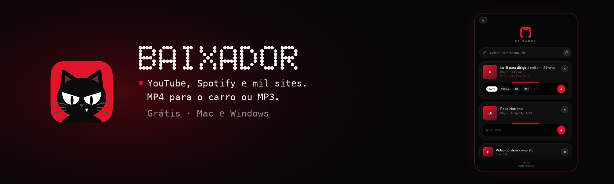
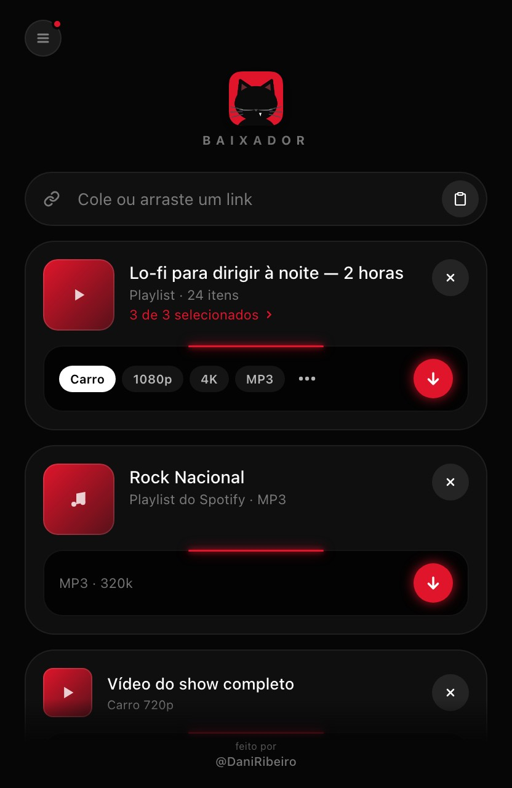
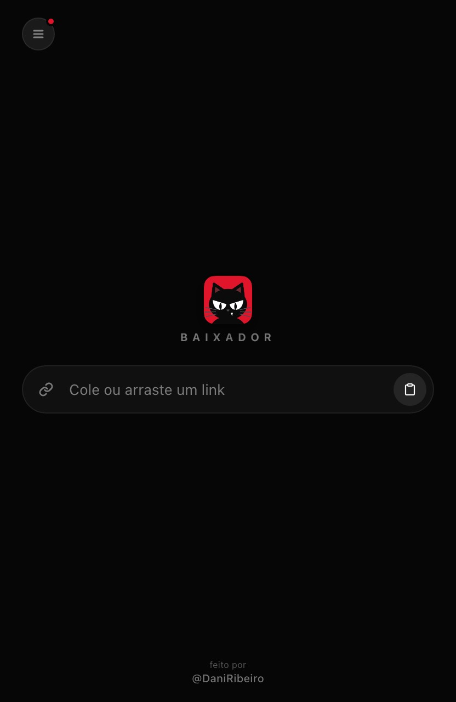
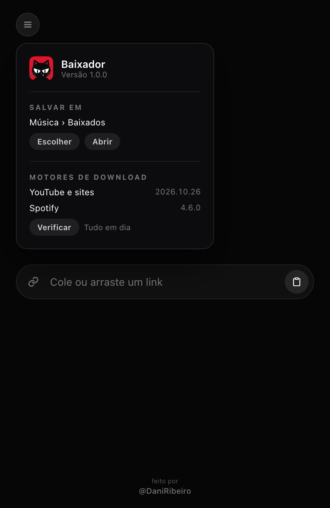

<p align="center">
  
</p>

<p align="center">
  <a href="https://github.com/odaniribeiro/baixador/releases/latest"></a>
  
  
  
  
  
</p>

<p align="center">
  <b>Cole o link e pronto: o vídeo ou a música vai para a sua pasta.</b><br>
  YouTube, Spotify e mais de mil sites, em MP4 que toca na central do carro ou em MP3 com capa.<br>
  Tudo já vem dentro do app: não precisa instalar mais nada.
</p>

<p align="center">
  <a href="https://github.com/odaniribeiro/baixador/releases/latest"><b>⬇ Baixar para Mac</b></a>
  &nbsp;·&nbsp; <a href="https://github.com/odaniribeiro/baixador/releases/latest"><b>⬇ Baixar para Windows</b></a>
  &nbsp;·&nbsp; <a href="#como-instalar">Como instalar</a>
</p>

---

## Veja em ação

Cole ou arraste o link, escolha a qualidade e clique na seta. A prévia mostra a capa e o título antes de baixar.

<p align="center"></p>

<details>
<summary>Mais telas</summary>

<p align="center">
  
  
</p>

</details>

## O que ele faz

| | |
|---|---|
| **Cole, arraste ou copie** | Cole o link, arraste da barra do navegador ou só copie: quando você volta ao app, o link copiado já aparece. |
| **Prévia antes de baixar** | Capa, título e duração. Em playlists do YouTube, você escolhe quais faixas quer. |
| **Qualidade para o carro** | **Carro 720p** e **480p** saem em MP4 H.264 com áudio AAC, o formato que quase toda central multimídia lê. |
| **Outras qualidades** | Full HD 1080p, Melhor (4K), Música MP3 320k com capa e artista, e Áudio M4A (no botão **···**). |
| **Spotify** | Músicas, álbuns e playlists viram MP3 320k com capa e nome certinho. |
| **Tudo organizado** | Uma pasta por playlist e por álbum: `Spotify/Playlists`, `Spotify/Álbuns`, `YouTube Vídeos`, `YouTube Músicas`. |
| **3 ao mesmo tempo** | Até três downloads juntos, com a porcentagem grande em cada cartão; o resto espera na fila. |
| **Motores sempre em dia** | Uma bolinha vermelha no menu avisa quando sai versão nova do yt-dlp ou do spotDL, e um clique atualiza. |

## Como instalar

### Mac

1. Baixe o **`Baixador-x.y.z.dmg`** na [página de versões](https://github.com/odaniribeiro/baixador/releases/latest).
2. Abra o arquivo e **arraste o Baixador para Aplicativos**.
3. Abra o app. **Na primeira vez**, o macOS pode avisar que não conhece o desenvolvedor: clique com o **botão direito** no app › **Abrir** › **Abrir**. Só é preciso uma vez.
4. Cole um link. Os arquivos vão para **Música › Baixados** (dá para trocar no menu do canto).

Se o macOS insistir em bloquear, rode no Terminal:

```bash
xattr -cr /Applications/Baixador.app
```

### Windows

1. Baixe o **`Baixador-x.y.z-Windows-Setup.exe`** na [página de versões](https://github.com/odaniribeiro/baixador/releases/latest).
2. Abra o instalador. Se aparecer **"O Windows protegeu o computador"**, clique em **Mais informações** › **Executar assim mesmo**. O aviso aparece porque o app não tem a assinatura paga da Microsoft.
3. Siga o instalador (não pede senha de administrador) e abra o Baixador pelo Menu Iniciar.
4. Cole um link. Os arquivos vão para **Música › Baixados** (dá para trocar no menu do canto).

## O que você precisa

- **Mac** com chip Apple (M1 ou mais novo) e macOS 14 ou superior, **ou** um **PC com Windows 10 ou 11** de 64 bits.
- Internet. Não precisa de conta, cadastro nem instalar mais nada: yt-dlp, spotDL, FFmpeg e Deno já vêm dentro do app.

## Segurança e privacidade

- **Não há conta, telemetria nem servidor do Baixador.** O app não coleta e não envia nada seu.
- **O que sai do computador:** o link que você cola vai direto para o site dele (YouTube, Vimeo etc.) para baixar o arquivo. Em links do Spotify, o app lê o título e a capa na página pública do Spotify, e o spotDL procura cada música no YouTube Music para baixar o áudio.
- **Atualização dos motores:** o app consulta as páginas de versões oficiais do yt-dlp e do spotDL no GitHub e, só quando você clica em **Atualizar**, baixa de lá a versão nova. O yt-dlp baixado é conferido pelo SHA-256 que o próprio projeto publica.
- **Permissões:** nenhuma especial. O app só grava na pasta que você escolher e na pasta de dados dele.
- **Integridade:** cada instalador desta página tem o seu arquivo `.sha256` ao lado, para conferir que veio inteiro.

## Atualizações

As versões novas do Baixador saem nesta página, de graça. Os **motores de download** (yt-dlp e spotDL) se atualizam pelo menu do canto, sem precisar baixar o app de novo: é o que resolve quando um site muda e os downloads começam a falhar.

## Limites conhecidos

- **Mac só com chip Apple.** Mac com processador Intel não é compatível.
- O app não é assinado pela Apple nem pela Microsoft, daí os avisos na primeira vez.
- **4K** do YouTube só existe em VP9 ou AV1: abre no computador, mas não em central de carro. Para o carro, use **Carro 720p**.
- Sites mudam sem aviso. Se um link parar de baixar, atualize os motores pelo menu; se continuar, conte para a gente.
- Conteúdo pago, privado ou protegido por DRM (Netflix, Disney+ etc.) não é baixado.

## Problemas e sugestões

Encontrou algo estranho ou tem uma ideia? **[Reportar problema ou sugerir melhoria](https://github.com/odaniribeiro/baixador/issues/new/choose)**. O formulário já pede o que ajuda a resolver, como a versão do app e do sistema.

As issues são públicas: não coloque nelas senhas, chaves de API nem dados pessoais.

## Créditos

Criado e desenvolvido por **Daniel Ribeiro** · Instagram [@odaniribeiro](https://www.instagram.com/odaniribeiro/).

Os downloads são feitos por projetos livres incríveis: [yt-dlp](https://github.com/yt-dlp/yt-dlp), [spotDL](https://github.com/spotDL/spotify-downloader) e [FFmpeg](https://ffmpeg.org).

## Termos e licenças

O Baixador é distribuído gratuitamente, **sem garantias**, e os direitos sobre ele são reservados ao autor. **Você é responsável pelo que baixa:** respeite os direitos autorais e os termos de uso de cada site. Veja os [termos de uso](TERMOS.md) e os [avisos de componentes de terceiros](TERCEIROS.md).
